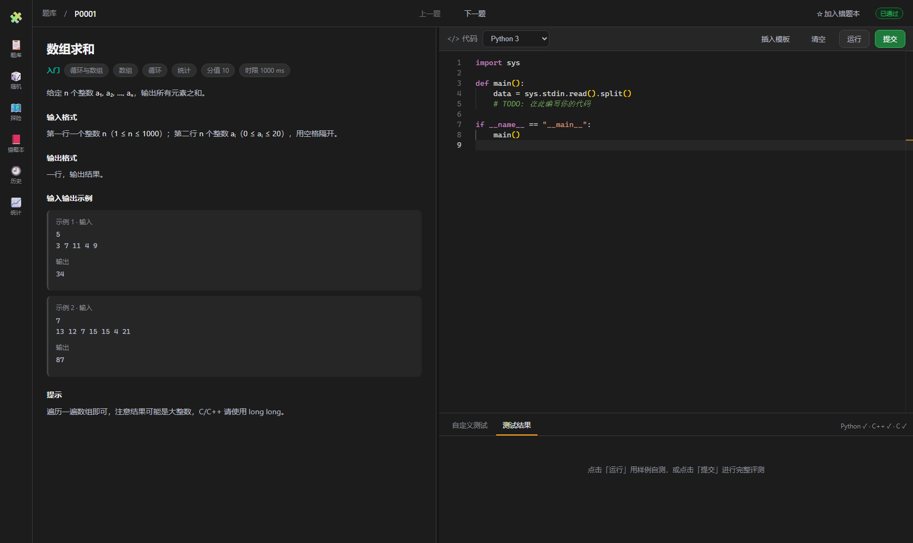
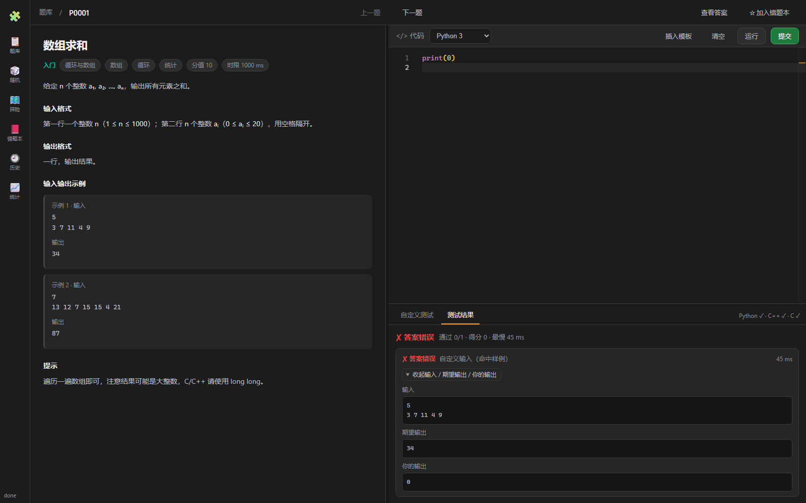
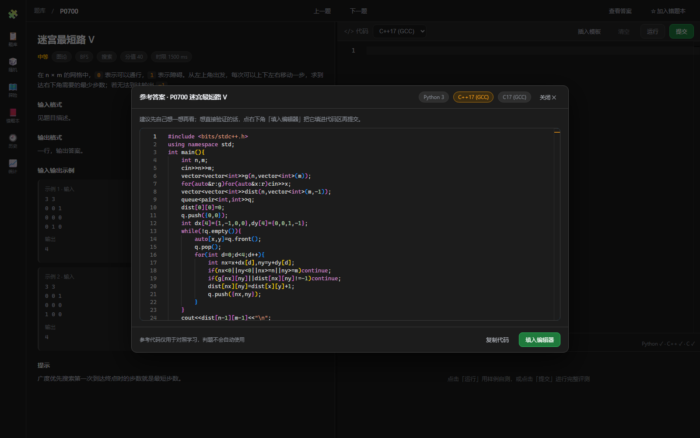
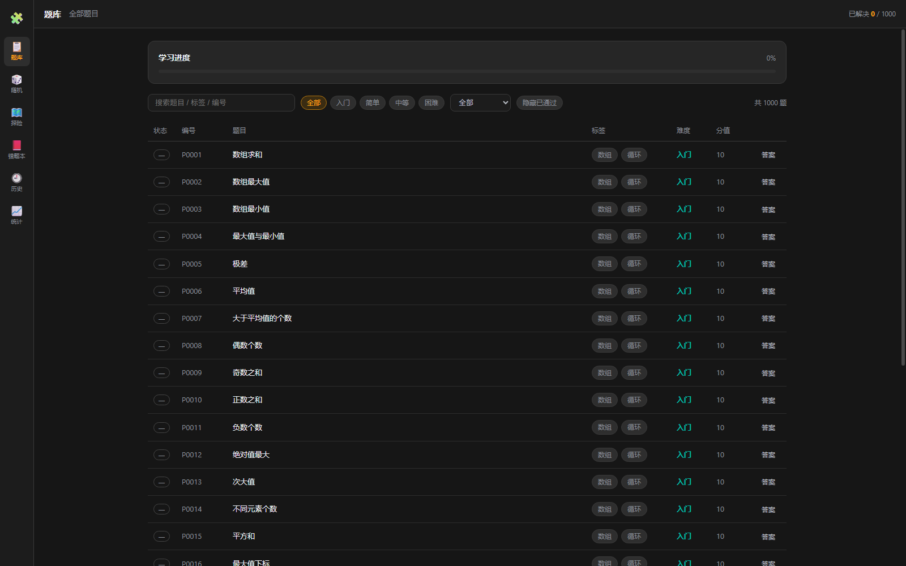
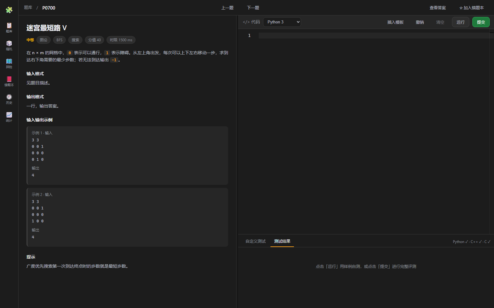
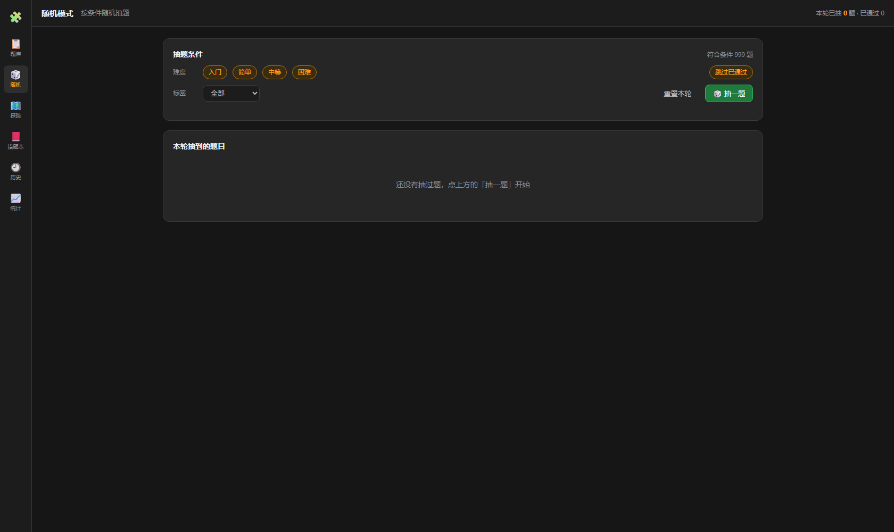
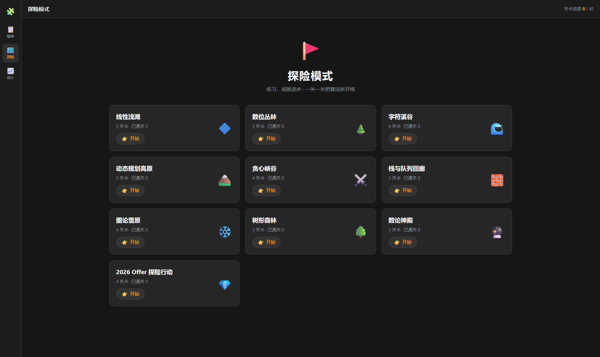
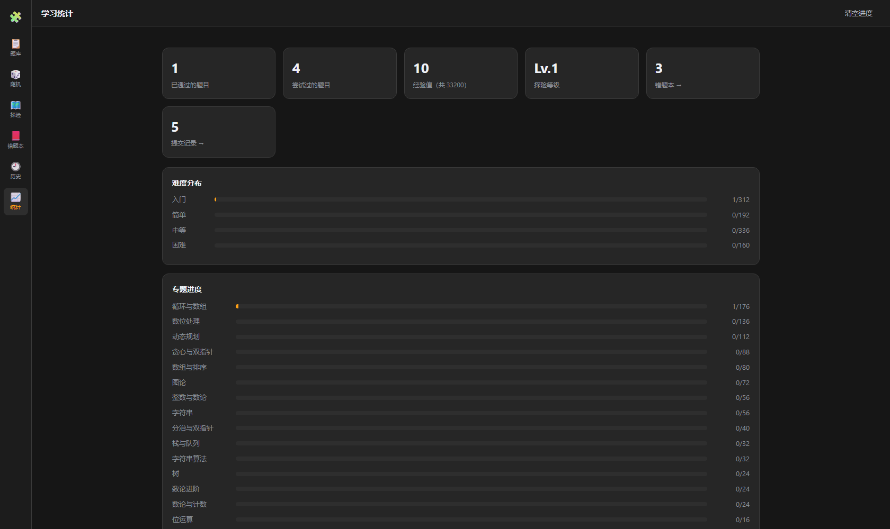

# CodeJudge · 多语言在线刷题平台

一个本地可运行的编程刷题网站：**题库模式** + **探险模式**，支持 **C / C++ / Python** 三种语言，
题目与编辑器同屏显示，提交后真实编译运行、逐测试点评分并给出详细结果。界面为参考 LeetCode 的深色风格。

## 界面预览

| 做题页（题目与编辑器同屏） | 出错用例可展开查看输入 / 期望输出 / 你的输出 |
| --- | --- |
|  |  |

| 参考答案（可拖动、三语言切换） | 题库列表（含「答案」入口） |
| --- | --- |
|  |  |

| 编辑器工具栏（插入模板 / 撤销 / 清空） | 随机模式 |
| --- | --- |
|  |  |

| 探险模式 | 统计数据 |
| --- | --- |
|  |  |

## 功能

- **题库模式**：1000 道题，难度覆盖 入门（312）· 简单（192）· 中等（336）· 困难（160）。
  支持关键词搜索、难度筛选、主题/标签筛选、隐藏已通过、分页浏览，进度与草稿保存在浏览器本地。
- **随机模式**：按难度（四档可多选）、标签筛选随机抽题；同一轮内不重复、可跳过已通过，
  抽到的题会在本轮列表留痕，做题页变成「换一题」继续随机。
- **探险模式**：10 个章节、40 个关卡。关卡按主题/难度从题库动态取题，通关后解锁下一关，
  带宝箱与隐藏关，纯前端进度（`localStorage`）。
- **做题页**：左侧题面（含样例、提示、输入输出格式），右侧 Monaco 编辑器，同屏显示。
  编辑器**默认是空板**，需要模板时点「插入模板」，也可以「清空」重来。
  支持 `运行`（自定义输入自测）与 `提交`（全部测试点评测）。
  评测结果里未通过的测试点会带上一个可折叠的小箭头，展开即可看到该例的「输入 / 期望输出 / 你的输出」；
  通过的测试点不显示这些内容。自定义输入如果正好是题面里的样例，也会照常和期望输出比对（不再一律判过），
  不匹配样例时只回显运行结果、不做对错判定。提交模式下只有样例测试点会展示数据，隐藏测试点仍然只给判定。
- **查看答案**：每道题（做题页右上角、题库列表「答案」列）都能打开参考答案弹窗，
  三语言可切换、C/C++ 代码自动重排版便于阅读，支持「复制代码」与「填入编辑器」。
  答案走独立接口，不会随题目详情下发，判题也不会自动使用它。
  弹窗可以用鼠标拖动；关闭再打开会回到居中位置。
- **提交历史**：记录每次提交的时间、题目、语言、判定、通过数与耗时；支持按判定 / 语言 /
  关键词筛选，并可「载入代码」回到当时提交的代码。
- **错题本**：提交过但未通过的题自动收录，也可以在做题页手动 `☆ 加入错题本`；
  按难度分组显示上次判定与尝试次数，支持重做与移出。
- **判题**：真实编译 + 真实运行，逐测试点比对，给出 `AC / WA / TLE / RE / CE / OLE` 判定、
  通过数、耗时与 0–100 分评分。
- **统计**：做题数量、难度分布、得分、通过率。

## 快速开始

环境要求：Node.js 18+、Python 3（用于判题）、一个 C/C++ 编译器（gcc/g++）；Windows 下可一键安装便携工具链。

```bash
npm install                 # 安装依赖（使用 npmmirror 源）
npm run setup               # 下载 MinGW-w64 工具链 + 生成题库（首次约 3 分钟）
npm run build               # 构建前端到 web/dist
npm start                   # 启动，浏览器打开 http://localhost:8787
```

开发模式（前端热更新，Vite 在 5173，代理 /api 到 8787）：

```bash
npm run dev
```

其他常用命令：

```bash
npm run generate                              # 只重新生成题库
node scripts/validate-dataset.mjs --python     # 校验 Python 参考解
node scripts/validate-dataset.mjs --compiled --compiled-step=5   # 抽样校验 C/C++ 参考解
node scripts/smoke-test.mjs                   # 端到端接口冒烟测试（需服务运行中）
node scripts/debug-one.mjs p0001 cpp          # 单题调试某个语言的参考解
```

环境变量：`PORT` 可改服务端口（默认 8787）。

## 部署上线（用正式域名访问）

判题要在服务器上真实编译并运行用户代码，所以**不能用静态托管**（GitHub Pages / Vercel / Netlify 都不行），
必须有一台能跑 Node.js 的 Linux 机器（VPS 或容器），并装好 gcc / g++ / python3。

### 方式 A：Docker（最省事）

```bash
git clone https://github.com/Liliwei-web/CodeJudge.git && cd CodeJudge
docker build -t codejudge .
docker run -d --name codejudge --restart unless-stopped -p 8787:8787 codejudge
```

### 方式 B：VPS / 云服务器手动部署

```bash
# 1) 系统依赖（Debian / Ubuntu）
sudo apt update && sudo apt install -y git build-essential python3 nginx

# 2) Node.js 20（用 NodeSource，比 apt 自带的新）
curl -fsSL https://deb.nodesource.com/setup_20.x | sudo -E bash - && sudo apt install -y nodejs

# 3) 拉代码、装依赖、构建前端
git clone https://github.com/Liliwei-web/CodeJudge.git && cd CodeJudge
npm ci && npm run build

# 4) 常驻运行（开机自启）
sudo npm i -g pm2
pm2 start server/src/index.js --name codejudge
pm2 save && pm2 startup
```

> Linux 上直接用系统 gcc/g++/python3，不需要 `npm run setup` 下载 MinGW 工具链；
> 题库 JSON 已经在仓库里，也不用重新 `npm run generate`。

### 绑定域名 + HTTPS

1. **解析域名**：在域名服务商添加一条 A 记录，指向服务器公网 IP。
2. **Nginx 反向代理**：

```nginx
server {
    listen 80;
    server_name codejudge.example.com;

    location / {
        proxy_pass http://127.0.0.1:8787;
        proxy_set_header Host $host;
        proxy_set_header X-Real-IP $remote_addr;
        proxy_read_timeout 300s;   # 判题可能较慢，别让 Nginx 提前断开
    }
}
```

3. **申请免费证书**：

```bash
sudo apt install -y certbot python3-certbot-nginx
sudo certbot --nginx -d codejudge.example.com
```

> 国内服务器用域名对外提供服务需要 ICP 备案；不想备案可以选境外 VPS，或先用 `http://IP:8787` 直接访问。

### 上线前请务必注意

- **判题会在服务器上执行用户提交的代码**，这是本机/自用工具的设计前提。公开对外之前至少要做到：
  跑在容器或低权限用户下、限制 CPU / 内存 / 磁盘、禁止被执行的程序访问外网、把 `server/src/routes/api.js` 里的并发闸门调低。
- 换端口：`PORT=9000 node server/src/index.js`。
- 做题记录全部存在用户浏览器本地，服务器不存任何数据，所以不需要数据库。

## 目录结构

```
codejudge/
├── server/                 # 判题服务（Express）
│   └── src/
│       ├── config.js       # 工具链探测（Python / gcc / g++）与子进程环境
│       ├── judge/          # 语言注册表、进程执行器、评测流程
│       ├── problems/       # 题库读取
│       └── routes/api.js   # REST 接口
├── web/                    # 前端（React + Vite + TypeScript + Monaco）
│   └── src/
│       ├── pages/          # 题库 / 随机 / 做题 / 探险 / 错题本 / 历史 / 统计
│       ├── components/     # Markdown（含轻量 LaTeX 渲染）、结果面板、参考答案弹窗
│       ├── random.ts       # 随机抽题：条件过滤、本轮去重、条件编解码
│       ├── format.ts       # C/C++ 参考代码重排版（仅展示用，不改语义）
│       └── store.ts        # 本地数据：进度 / 草稿 / 提交历史 / 错题本 / 偏好
├── scripts/                # 题库生成、校验、冒烟测试
│   ├── families/           # 题目「原型」：intro / easy / medium / hard（+ *_extra 扩充题族）
│   ├── lib/                # 输入形状（shapes）、题面引擎（tasks / arrcond / strcond / preds）、校验器
│   ├── generate-problems.mjs  # 展开题族 -> data/problems/
│   ├── audit-families.mjs  # 审计题族：重复标题 / 相同参考解
│   ├── audit-bank.mjs      # 审计已生成题库
│   └── check-family.mjs    # 单个题族快速构建 + 真实编译校验
├── tools/                  # MinGW-w64 工具链安装脚本
└── data/problems/          # 生成后的题库（index.json + 每题一个 json）
```

## 题库是怎么来的

题库里的 **1000 道题互为不同的题型**（不靠「同一道题换数据规模」凑数），全部都有可自动判分的数据：

- `scripts/families/*.mjs` 中每个题型只需写 4 段代码：`js`（生成标准答案）、`py`、`cpp`、`c`（三语言参考解）。
- 输入输出由 `scripts/lib/shapes.mjs` 的「输入形状」统一描述，自动处理三语言读取与随机数据生成。
- `scripts/lib/tasks.mjs` 是轻量题面引擎：一行表格就能描述一道题（题面 / 输入输出 / 三语言代码）。
- `scripts/lib/arrcond.mjs`、`strcond.mjs`、`preds.mjs` 用「元素谓词 × 归约方式」交叉出大批
  互不相同的数组 / 字符串统计题（`*_extra.mjs` 题族即由它们批量产出）。
- 每个题型只对应 **1 道题**，生成时同步产出 2 个样例 + 10 个测试点（样例也会出现在题面中）。
- 审计脚本 `npm run audit:families` / `npm run audit:bank` 会检查**重复标题**与**完全相同的参考解**，两者都必须为 0。

当前构成：入门 312 · 简单 192 · 中等 336 · 困难 160 = **1000**。

> 说明：题库由 `data/problems/` 下的 JSON 描述，不含二进制大文件；重新生成即可覆盖。

## 判题接口

```
GET  /api/health                 服务与工具链状态、题库统计
GET  /api/problems               题目列表（元数据）
GET  /api/problems/:id           题目详情（不含隐藏测试点与参考解）
GET  /api/problems/:id/solution  参考答案 { solutions: [{ id, name, code }] }，按需请求
POST /api/run                    { problemId, language, source, input? }  自测
POST /api/submit                 { problemId, language, source }          完整评测
```

评测结果结构：

```jsonc
{
  "mode": "submit",
  "language": "python",
  "verdict": "AC",          // AC / WA / TLE / RE / CE / OLE
  "score": 100,             // 0-100
  "passed": 10, "total": 10,
  "maxTimeMs": 312,
  "compile": { "ok": true, "output": "" },
  "cases": [ { "index": 0, "verdict": "AC", "timeMs": 42, "actual": "..." } ]
}
```

## 说明与边界

- 三种语言均使用系统或便携工具链真实编译运行；C/C++ 编译加 `-O2 -std=gnu17`。
- 时限 = 题目时限 × 语言系数 + 2500ms 进程启动缓冲（并在计时前先空跑一次，消除新程序的冷启动开销）；内存与输出均有上限，输出超限判 `OLE`。
- 判题并发受限（默认 2），临时文件写入 `%TEMP%/codejudge-work`（纯 ASCII 路径，避免 MinGW 中文路径问题）。
- 无需登录，所有数据保存在浏览器本地（`localStorage` 键 `codejudge.progress.v2`）：
  做题进度、代码草稿、探险进度、提交历史、错题本、偏好设置；清空浏览器数据会丢失。
- 提交历史上限 500 条，单条源码截断到 8000 字符，源码总量超预算时自动剥离较旧记录的源码；
  写满配额时先丢弃历史源码重试，仍失败则只在内存中保留。
- 偏好设置里的「打开题目时自动插入模板」默认关闭（即默认空板）。

## 许可

本项目使用 [MIT License](LICENSE)。